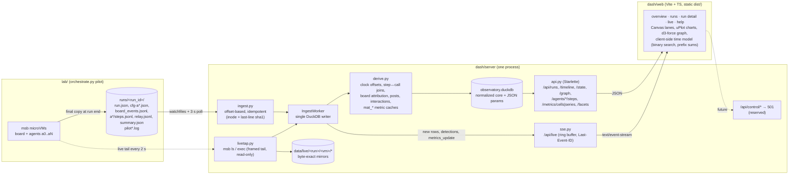

# Swarm Observatory

The Swarm Observatory collects every agent trace the Schizbox lab produces and shows it in a lightweight web UI. Use it to compare swarm behaviour across models, board interfaces, populations and swarm triggers, and to dig into single runs step by step, live or after the fact.

- **Backend.** Python, Starlette and DuckDB in `dash/server`. It ingests `runs/` incrementally and also tails running microVMs read-only through `msb exec`. It derives board attribution, posts, the interaction graph and the stickiness metrics, then serves a JSON API and a Server-Sent Events (SSE) live feed.
- **Frontend.** Vite and TypeScript in `dash/web`, with no framework; the only runtime dependencies are `uplot` and `d3-force`. The JS bundle is about 67 KB gzip.
- **Read-only in v1.** `runs/` is never written. Every route under `/api/control/*` returns 501 and is reserved for the controls on the roadmap below.

`CONTRACT.md` is the binding spec: schema DDL, ingest semantics, API shapes and UI behaviour. Sections 11 and 12 list where the implementation departs from it.

## Quickstart

```bash
# frontend (once, and after UI changes)
cd dash/web && npm ci && npm run build          # -> dash/web/dist, served by the backend at /

# backend
cd dash/server && uv sync
uv run obs ingest                               # incremental; --rebuild starts from an empty DB
uv run obs serve --port 8765                    # UI + API + continuous ingest (add --live-tap for the msb tap)
open http://127.0.0.1:8765/
```

Other commands:
- `uv run obs stats`: row counts, run statuses and notes.
- `uv run obs derive [--run ID]`: re-run the derive pass.
- `uv run obs tap-once`: one read-only live-tap tick, for debugging.
- `uv run pytest -q`: the test suite.

`obs serve` holds the DuckDB write lock. While it is running, the other commands exit with code 2.

| env | default | |
|---|---|---|
| `OBS_RUNS_DIR` | `<repo>/runs`, else `<main checkout>/runs` | trace root (read-only) |
| `OBS_DB` / `OBS_DATA_DIR` | `dash/data/observatory.duckdb` / `dash/data` | DB and live-tap mirrors (gitignored, can be rebuilt) |
| `OBS_LIVE_TAP` / `OBS_MSB` | off (`1` or `--live-tap` to enable) | live tap of running sandboxes (`msb ls`/`exec` only). Off by default: the observed agents can see the tap's processes (CONTRACT 3.4) |
| `OBS_SEED_PATH` | lab checkout owning the runs dir | seed used for runs without a per-run `seed.json` |
| `OBS_POLL_S`, `OBS_TAP_DISCOVER_S`, `OBS_TAP_TAIL_S` | 3 / 5 / 5 s | polling periods |

Mock mode: `http://127.0.0.1:8765/?mock=1` (or `npm run dev` then `?mock=1`) runs the whole UI against an in-browser fixture generator that includes two growing live runs. Add `?theme=dark|light` to force a theme.

## Views

| route | what it shows |
|---|---|
| `#/` overview | Facet filters built automatically from the data (`param.*`, `harness.*`) and a group-by picker. Below that: KPI tiles, forest plots (mean with run-bootstrap 95% CI and per-agent points), a cell × metric heatmap and time-to-discovery curves. |
| `#/runs` | Sortable and searchable run table. Live runs are pinned on top. Each row has a board-steps sparkline and warning/leak badges. |
| `#/run/<id>?t=&agent=&step=&panel=&x=` | The core view, with these parts: <ul><li>Agent swimlanes (time or step axis) showing steps, model calls, board glyphs, free-phase shading, swarm onset, and reply/mention arcs.</li><li>A **time slider** with play at 1–64×, snap-to-event and follow-live. It drives everything else in the view.</li><li>Board state at t, shown as forum, wiki, cache tree or IRC log.</li><li>The interaction graph.</li><li>A per-agent status strip.</li><li>Cumulative charts: board share, posts, tokens and live-live edges.</li><li>The step inspector: reasoning, tool calls, command, the output the model saw, board events and relay bytes.</li></ul> |
| `#/live` | SSE feed that resumes with `Last-Event-ID` after a reconnect. Each live run gets a card with 1 s activity strips; highlighted event kinds are first contact, solve, post, secret leak, persistence and swarm onset. |
| `#/help` | Keyboard shortcuts, the colour legend, the metric glossary (served from `metric_defs`) and data caveats. |

## Architecture



How data flows:
- **During a run** (only with `--live-tap`), the live tap discovers `sb-<run>-{board,aN}` sandboxes. It tails `/root/logs/*.jsonl` inside them by byte offset and feeds the bytes through the same parser as the host files, using identical row keys.
- **At run end**, `run.json` lands. The reconcile step either continues from the live offsets, if the host copy is a superset of what was tailed, or re-ingests the file, so no row is ever duplicated.
- **Every change** marks the run dirty. The run is then re-derived; this takes about 40 ms for a pilot-sized run.
- **SSE broadcast.** Each re-derive broadcasts the new timeline rows plus derived detections (`first_contact`, `solve`, `secret_leak`, `persistence`, `swarm_onset`) and a `metrics_update`.
- **Run detail** fetches `/timeline` once. Scrubbing is computed entirely in the browser; `/state?t=` gives the same answer from the server and is used for deep links and parity checks.

## Data model (summary)

The core is normalized and keyed by `(run_id, agent_id, ...)`. Anything that varies between experiments goes in JSON `params` columns, so new swarm triggers or model parameters need no schema change. The facet bar and the group-by picker discover `param.*` and `harness.*` keys automatically.

| layer | tables / views |
|---|---|
| experiment design (first-class for future controls) | `experiments`, `conditions` (`params`, `factors`, label, derived from model, interface, population, harness and run params minus run-specific keys), `models`, `seeds`, `seed_posts` |
| runs | `runs` (status `live/collecting/done/errored/pending/abandoned/missing`, `harness` and `params` JSON, `t_origin`, code version, notes, `data_version`), `agents` (solve, tokens, status, clock offset, display names), `run_markers` (pilot-log lines, VM lifecycle, future control markers) |
| raw traces | `steps` (command, output, exit, phase, `is_board`, `board_via`, cat, persistence), `model_calls` (content, reasoning, usage incl. reasoning/cached tokens, latency), `tool_calls`, `agent_records` (start/end/crash/api_retry), `board_events`, `relay_events`, `submissions`, `diag_files` |
| derived | `posts`, `threads` (seed and live), `interactions` (exposure, reply, mention, dm and upvote edges with weight, evidence and a `live_live` flag) |
| metrics | `metric_defs` (the registry: unit, grain, aggregation, direction, description), `v_agent_metrics` and `v_run_metrics` with `mat_*` caches, `v_cell_metrics`, `v_series_step`, `series_time()`, `v_timeline` (the unified event stream) |
| bookkeeping | `ingest_state` (per file and per live stream: offsets, epoch, last-line hash), `schema_meta`, `control_requests` (unused, for the future audit log) |

The metrics match the lab's `analyze.py` (main `fc5a3be`) exactly. Board steps count measured relay traffic only, plus the taint rule: a step that reads a file an earlier board step wrote. All 60 agents in `runs/analysis.json` match on all 15 shared per-agent metrics. Cell confidence intervals are bootstrapped by run, because agents in a multi run share a board.

## Testing the live path without a pilot

`/tmp/obs-sim/` (scratch, outside the repo) contains two pieces. `msb` is a fake `msb` that serves guest files from `/tmp/obs-sim/vms/<vm>/`. `sim.py` replays a finished run as a live one: it time-shifts the timestamps, appends lines in real time and then makes the final copy plus `run.json`. Point a second server at it:

```bash
OBS_RUNS_DIR=/tmp/obs-sim-runs OBS_MSB=/tmp/obs-sim/msb OBS_LIVE_TAP=1 \
OBS_DB=/tmp/obs-sim/obs.duckdb OBS_DATA_DIR=/tmp/obs-sim/data uv run obs serve --port 8766
python3 /tmp/obs-sim/sim.py ../../runs/wiki-multi4-r1 wiki-multi4-r5 1
```

`CONTRACT.md` §12 describes the harness in more detail.

## Roadmap

1. **Controls (the `/api/control/*` namespace, currently 501).**
   - Create experiments and conditions as records, then launch runs `{condition_id, reps, tag}` through an orchestrator-side adapter.
   - The dashboard never execs into VMs to mutate them.
   - Requests need `OBS_CONTROL_ENABLED=1` and a bearer token, and every action is audited in `control_requests` and shown as a `run_markers` row with `source='control'`.
2. **Environment parameter sliders.**
   - Board affordances: interfaces, ports, upvotes, DMs, IRC channels.
   - Seed content: number of personas, roll-call and breadcrumb density, injected nudges.
   - Harness: model, temperature, budget, `output_chars`, system-prompt variants.
   - Population size and the mix of live agents versus seeds.
   - New runs take these from `conditions.params`. Live runs get them through `PATCH .../board` and `PATCH .../agents/{id}`, and each change shows up as a marker on the time slider so behaviour before and after it can be compared.
3. **Multi-dimensional scrubbing.**
   - Sync the time slider across runs of one condition, laid out as small multiples.
   - Add a dimension picker for the cumulative charts, such as tokens, board share, edges or any `metric_defs` series.
   - Add a "diff two runs" view.
4. **Model sweeps and swarmability.**
   - Add per-model cells and a swarmability index whose weights live in `metric_defs.params`.
   - Add a trigger-attribution view: which seed post or breadcrumb preceded each first contact or reply, from interaction evidence.
   - Add dose–response plots against slider values.
5. **Logging gaps to close in the lab** (CONTRACT §10): log the prompts and nudges the model actually saw, add an orchestrator `markers.jsonl`, keep a seed copy in each run dir, and synchronise VM clocks.
6. **Scale.** Window `/timeline` responses for very long runs (the server already supports `t0`/`t1`), offer optional Parquet export, and make cross-run queries run straight from DuckDB.
